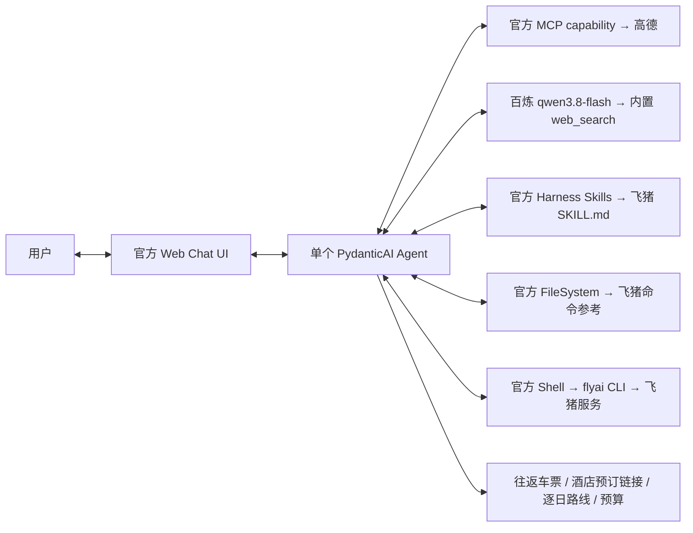

# 国内旅行 Agent

使用 **一个 PydanticAI Agent** 完成需求澄清、往返车票与酒店查询、路线核验、逐日行程及预算比较。
直接运行官方 Web Chat UI，不自建前端和编排框架。



Skill 是旅行领域说明与操作流程；真正执行查询的是官方 CLI。
`Skills` 负责按需加载，`FileSystem` 负责读取配套命令参考，`Shell` 负责执行 `flyai`。
这几个组件属于同一 Agent，没有子 Agent。

## 启动

需要 Python 3.12+、uv 和 Node.js。推荐在项目根目录运行：

```bash
uv sync
npm install -g @fly-ai/flyai-cli
cp .env.example .env
```

在 `.env` 填写 `AMAP_MAPS_API_KEY` 和 `DASHSCOPE_API_KEY`。
默认模型为百炼 **`qwen3.8-flash`**，`TRAVEL_MODEL` 直接填写百炼模型 ID。
通过官方 `OpenAIResponsesModel` / `AlibabaProvider` 连接百炼 OpenAI Responses 兼容接口，
通过官方 `WebSearch()` capability 启用百炼内置 `web_search`，与高德、飞猪工具一起使用。
通过 `OpenAIResponsesModelSettings(openai_reasoning_effort="none")` 关闭思考模式。
`DASHSCOPE_BASE_URL` 默认为北京按量计费兼容地址
`https://dashscope.aliyuncs.com/compatible-mode/v1`；使用业务空间端点时改为控制台对应的
`https://{WorkspaceId}.cn-beijing.maas.aliyuncs.com/compatible-mode/v1`。
地域、端点和 Key 需要配套。

`settings.py` 使用官方 Pydantic Settings：环境变量优先于项目根目录的 `.env`，
所有凭据使用 `SecretStr`，不再通过 `load_dotenv` 修改进程环境。
高德 Key 需要在开放平台申请 **Web 服务** 类型。
飞猪可试用，正式使用可配置 `FLYAI_API_KEY`；CLI 也支持本机已有配置。

```bash
uv run uvicorn app:create_app --factory --host 127.0.0.1 --port 7932
```

打开 **http://127.0.0.1:7932**。
官方 UI 首次访问会从 CDN 获取页面资源，需要能够访问 CDN。
这里使用的是本地开发 UI；面向公众部署时需另行接入身份验证与会话存储。

示例输入：

> 帮我规划 2026 年 12 月 4 日到 6 日从上海去杭州的旅行，2 个成人，
> 总预算 3000 元，往返高铁二等座，一间双床房，想去西湖和灵隐，节奏轻松一点。
> 给我去回车票、酒店预订链接和每天的路线。

## 规划过程

1. 提取出发地、目的地、日期、人数、预算与偏好，集中询问必要的缺失信息。
2. 加载飞猪 Skill、读取命令文档，分别查询去程与回程，查询实际入住日期的酒店。
3. 用高德核对酒店、车站、景点位置及交通耗时，按地理位置与到离站时间安排每日路线。
   用百炼内置搜索补充官方开放时间、预约政策和近期公告，附来源链接。
4. 给出有依据的候选、预订链接、逐日安排和预算，区分实时报价与估算。
5. 用户修改需求后，重新查询受影响的商品和路线。

预订由用户通过工具返回的飞猪链接完成；当前版本不代下单、锁票或支付。
没有价格、余票、房型或退改信息时明确标注待核实。工具失败时说明未完成的部分，
不编造报价和链接。行程约束目前由 Agent 指令执行，尚无独立求解器或预算校验器。

## 文件

| 文件 | 用途 |
| --- | --- |
| `app.py` | 创建 Agent 与官方 Web 应用 |
| `settings.py` | 用 Pydantic Settings 读取、校验环境配置 |
| `instructions.md` | 需求澄清、工具使用、路线和预算规则 |
| `skills/flyai/` | 飞猪上游 Skill、命令参考和许可 |
| `skills/UPSTREAM.md` | 飞猪 Skill 来源记录 |
| `AGENTS.md` | 开发约定，包含优先使用官方集成 |
| `tests/test_app.py` | 离线工具链与 Web 接口验证 |

```bash
uv run python -m pytest -q
```

测试使用官方 `FunctionModel`、本地地图/CLI 替身，验证 Skill 加载、文档读取、
命令调用和工具限制，以及官方 Web 健康检查与配置接口。
另有配置优先级测试和 HTTP Mock 测试，验证真实模型适配器发送 `qwen3.8-flash`、
`web_search`，以及与本地 function tools 共存、普通响应和流式响应解析。
这些测试不证明真实服务可用，也不评估模型生成行程的质量；配置真实密钥后应再验证完整查询。

本次环境通过已有依赖缓存离线安装并验证，未执行真实旅游商品或地图查询。

## 官方参考

- [PydanticAI 文档入口](https://pydantic.dev/docs/ai/llms.txt)
- [官方 Web UI](https://pydantic.dev/docs/ai/integrations/web/)
- [官方 MCP capability](https://pydantic.dev/docs/ai/capabilities/mcp/)
- [官方 Skills](https://pydantic.dev/docs/ai/harness/skills/)
- [官方 Shell](https://pydantic.dev/docs/ai/harness/shell/)
- [Pydantic Settings](https://docs.pydantic.dev/latest/concepts/pydantic_settings/)
- [百炼联网搜索](https://help.aliyun.com/zh/model-studio/web-search)
- [百炼 OpenAI Responses 接口](https://help.aliyun.com/en/model-studio/compatibility-with-openai-responses-api)
- [高德 MCP 接入](https://developer.amap.com/api/mcp-server/gettingstarted)
- [飞猪官方 Skill](https://github.com/alibaba-flyai/flyai-skill)
- [飞猪平台快速开始](https://flyai.open.fliggy.com/docs/quickstart)
